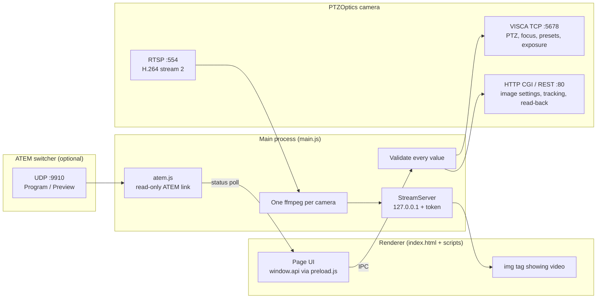

# SOTH Cam Control

A desktop app (Electron) for controlling and monitoring four PTZOptics Move SE cameras during a livestream:
live multiview, pan/tilt/zoom, focus, presets, one-button **scenes** (a preset on every camera at once), exposure / image / color / tracking drawers with live read-back,
visual alerts when a camera is in an abnormal state (tracking on, manual focus, focus locked, values that differ from the other cameras),
and, with an optional Blackmagic **ATEM** link, Program/Preview badges that keep scenes and presets from moving the camera that is on air.

Default cameras: South 192.168.0.200, Center .201, North .202, Rear .203. Change names and addresses in **Settings**.

## Requirements
- Node 22 and npm (to run or build from source)
- Cameras reachable on the local network (Ethernet recommended)

## Run
```
npm install
npm start
```
Use `npm start`, not `electron .`: VS Code terminals set `ELECTRON_RUN_AS_NODE=1`, which makes Electron exit silently. `npm start` clears it.

## Keyboard
Pan, tilt, zoom and focus each have their own speed slider, limited to the camera's documented ranges (pan 1–24, tilt 1–20, zoom 1–7, focus 1–7); the keys use the same speeds.
Arrow keys pan/tilt (hold to move, release to stop), Space stops, `H` goes Home, `1`–`4` selects a camera, `Esc` closes a drawer.
Shortcuts are ignored while typing in a field.

## Scenes
A scene is a named button (up to 12) that recalls one preset on every camera at once, e.g. Sermon, Baptism, Choir. Add them in **⚙ Settings → Scenes**: a name plus a preset number (1–254) per camera; leave a camera blank to keep it where it is. The last scene pressed stays highlighted until a camera in it moves (by hand, by tracking, or by any move/zoom/home/preset command).

### ATEM switcher (optional)
In **⚙ Settings → ATEM switcher** enter the switcher's address and which ATEM input each camera is on. The app then shows a red **PGM** (Program) and green **PVW** (Preview) badge on those tiles. The link is read-only; nothing is ever sent to the switcher.
Scenes never move the camera that is on air: its recall is held, the scene button turns amber, and the move is sent as soon as that camera leaves Program. An operator move, or pressing another scene, cancels a held move. The preset buttons (1–10) ask for confirmation before moving a camera that is on air. A Preview camera moves normally. If the ATEM is unreachable, scenes move every camera and the panel warns about it; a move that was already held waits until the ATEM is back rather than being sent blind. Only the first mix effect's Program/Preview is read, so a camera shown through a keyer or picture-in-picture is not detected.

## Settings and environment
- Settings are saved in the app's user-data folder as `config.json`; a missing or damaged file falls back to defaults (valid fields are kept).
- `SOTH_FFMPEG=/path/to/ffmpeg` uses a different ffmpeg.
- `SOTH_TEST_HIDDEN=1` keeps the window hidden (used by the app test).
- Only one copy of the app can run at once (cameras allow one VISCA session each).

---

# Developer guide

## What it is built on
| Piece | Used for |
|---|---|
| [Electron](https://www.electronjs.org/) 45 | Desktop shell: a Node.js main process plus a sandboxed Chromium renderer |
| Plain JavaScript (CommonJS in main, classic `<script>` files in the page) | No framework, no bundler, no transpiler |
| [ffmpeg-static](https://www.npmjs.com/package/ffmpeg-static) | Bundled ffmpeg binary that turns each camera's RTSP video into something the page can show |
| Node built-ins (`http`, `net`, `child_process`) | Talking to cameras and serving video; the only runtime dependencies are ffmpeg-static and atem-connection (the ATEM link) |
| electron-builder | Packaging (Windows portable exe, unpacked Mac app) |
| ESLint 10 + `node --test` | Lint (zero warnings) and unit tests |

## How it works



**Control.** The page never talks to a camera directly. It calls `window.api` (defined in `preload.js` with `contextIsolation` on, `nodeIntegration` off and `sandbox` on), which sends an IPC message to the main process. `main.js` treats every message as untrusted: the camera index, command type and each value are range-checked (`validate.js`, the `IMAGE_RANGE` table, etc.) before anything is sent. Two protocols are used:
- **VISCA over TCP** (`visca.js`, port 5678): movement, zoom, focus, presets, exposure mode, iris/shutter/gain, and position read-back. One persistent connection per camera; inquiries are queued one at a time.
- **HTTP** (`camhttp.js`, port 80): the CGI endpoints (`ptzctrl.cgi`, `param.cgi`) for image/color settings and for reading the camera's configuration, plus the REST API `/api/v1/control/track` for auto-tracking. Tracking writes accept only a whitelist of fields and values, and the UI only ever sends them to one camera.

**Read-back and alerts.** The renderer polls each camera on timers (position every 0.5 s; image, advanced/exposure and tracking every 2 s; ATEM Program/Preview every 0.4 s; stream health every 1 s). Each drawer shows live values, and `core.js` compares cameras so a camera that is tracking, in manual focus, focus-locked, or differs from the others lights up on its tile.

**Video.** `streams.js` starts one ffmpeg process per camera that reads `rtsp://<ip>:554/2` over TCP and outputs MJPEG. A small HTTP server bound to `127.0.0.1` re-serves each as a multipart stream that a plain `` displays. Requests must carry a random per-run token and a loopback Host header. Feeds reconnect with a growing delay (2 s up to 15 s), slow viewers are cut off rather than buffered without limit, and the last ffmpeg error is shown on the tile when a feed is down.

**Scenes and the ATEM.** A scene is `{ name, presets: [preset or null per camera] }` in `config.json`; `scenes.js` sends one `presetRecall` per camera in parallel. `atem.js` (main process) wraps the [atem-connection](https://www.npmjs.com/package/atem-connection) library, read-only, and exposes `status()` = `{ enabled, connected, program, preview }` for the first mix effect; `onair.js` polls it and maps ATEM inputs to cameras (`config.atem.inputs`). A scene's camera that is on air is held in `activeScene.pending` and released when it leaves Program (never while the ATEM is disconnected). `scenewatch.js` is pure logic that decides when a recalled scene has settled and when a camera has since moved, which clears the highlight; it has unit tests. The app test replaces `atem.js` with a fake, so the real library is never started there.

**Settings.** `config.js` holds defaults, validation and tolerant loading (camera names and addresses, scenes, ATEM address and inputs). `config:set` validates, writes `config.json`, rebuilds the VISCA clients, restarts the video feeds and restarts the ATEM link when its address changed.

**Copy to other cameras.** `copyflow.js` holds the logic for applying one camera's setting to the others (shared by several drawers); it is plain code with unit tests.

## Code layout (`src/`)
Main process: `main.js` (window, IPC, command validation), `camhttp.js` (HTTP to the cameras), `visca.js`, `streams.js` (ffmpeg video), `config.js`, `validate.js`, `atem.js` (ATEM link), `preload.js` (the only bridge to the page).
The page is plain scripts that share one global scope, loaded in this order by `index.html`: `util`, `copyflow`, `core` (shared state and helpers), then one file per area
(`tiles`, `controls`, `settings`, `position`, `exposure`, `drawers`, `image`, `adv`, `color`, `scenewatch`, `onair`, `scenes`, `tracking`) and `app` last (start-up).
New page scripts must be added to `index.html`; lint reads that list, so it knows their shared names.

Other folders: `test/unit` (unit tests), `test/app` (end-to-end test), `scripts/` (run and build helpers), `docs/camera-notes.md` (verified camera behavior).

## Commands
| Command | What it does |
|---|---|
| `npm start` | Run the app |
| `npm run lint` | ESLint, zero warnings allowed |
| `npm test` | Unit tests (validators, config incl. scenes and ATEM settings, scene watch, copy logic, VISCA client, ffmpeg failures, video server) |
| `npm run test:app` | Launches the real app hidden, with a fake camera network that records writes and never touches a real camera, and checks the UI end to end |
| `npm run dist:win` | Windows portable exe in `dist/` |
| `npm run dist:mac` | Unpacked Mac app in `dist/` |

## Build and release
`ffmpeg-static` installs only the binary for the platform you run `npm install` on, so **build each platform on that platform**. The build scripts (`scripts/ffmpeg-check.js`) check that the bundled ffmpeg matches the target, both before and after packaging, and refuse to continue if it does not. In the packaged app ffmpeg is unpacked from the asar (`asarUnpack`). `npmRebuild` is off in the build config: `atem-connection` pulls in a native module (`@julusian/freetype2`) that ships prebuilt binaries, and letting electron-builder recompile it needs Visual Studio and fails without it.

**Windows:** releases are built on a Windows machine, not in CI. To make one: bump `version` in `package.json` (`npm version X.Y.Z --no-git-tag-version`), run `npm run lint`, `npm test` and `npm run test:app`, then `npm run dist:win` (it makes `dist/SOTH-Cam-Control-portable.exe`). Commit, tag (`git tag -a vX.Y.Z -m vX.Y.Z && git push origin main vX.Y.Z`) and publish with `gh release create vX.Y.Z dist/SOTH-Cam-Control-portable.exe --title vX.Y.Z --notes "..."`. The unit tests that use fake POSIX ffmpegs (the video server and feed-failure tests) are skipped on Windows; run `npm test` on Linux or in WSL as well when you change `streams.js`. The exe needs no Node or npm on the machine that runs it. It is not code-signed, so Windows SmartScreen may warn: choose More info > Run anyway.

**Mac:** run `npm run dist:mac` on a Mac. The app is ad-hoc signed (`scripts/adhoc-sign.js`) and includes a Local Network usage description (see below).

## Troubleshooting a tile that says NO SIGNAL
The tile shows the reason when it knows it:
- **ffmpeg not found / wrong platform**: reinstall dependencies on this platform, or set `SOTH_FFMPEG`.
- **Connection refused / timed out**: camera off, wrong address, or not on the same network.
- **Connection works but no video**: another RTSP client may be using the stream, or the camera needs a reboot (South once needed one for stuck tracking).

## Mac: packaged app freezes or shows "No route to host"
macOS blocks apps from local-network devices until they are allowed in **System Settings → Privacy & Security → Local Network**. Without it the feeds say "No route to host" and the app can freeze (beach ball) because closing the blocked sockets stalls.
The build includes the permission text and is ad-hoc signed, but macOS may still not list or prompt for it. Copy the app to /Applications, open the Local Network page, click **+**, add *SOTH Cam Control.app*, then relaunch (this fixed it on the development Mac). `npm start` always works because Electron.app is already allowed. Windows has no such permission.

## More
Verified camera behavior, command formats and gotchas: [docs/camera-notes.md](docs/camera-notes.md).
